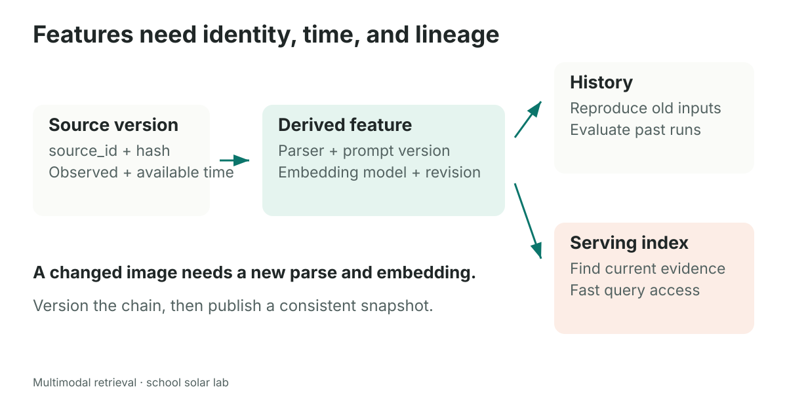
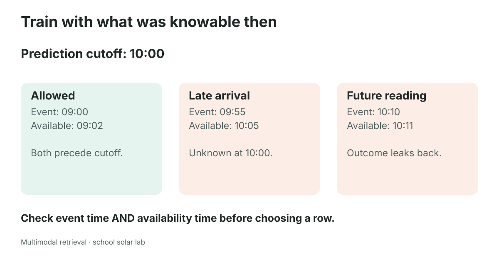

# Feature stores: remembering what a model knew, and when

A search result can be wrong even when every line of retrieval code works. Imagine that your team corrects the solar chart from **57 kWh** to **59 kWh**, but the search index still contains an embedding of the old caption. Search returns the right filename; the reader opens a new image; the cached description says something different. Which version did the system actually use?

The values in this opening example are a **hypothetical update**, not a change to the teaching corpus. The corpus keeps May at 57 kWh. This distinction is the point of the lesson: derived information needs a clear connection to its source version.

A **feature** is a derived value that a system uses as input. For multimodal retrieval, features can include an embedding, an OCR text block, a chart's extracted values, an image-quality flag, or a document's page count. In a prediction task, features might instead be the last hour's average temperature or a student's completed exercise count. A feature's meaning includes how it was computed, for which entity, and using which information.

A **feature store** is an organized system for defining, storing, and retrieving such values consistently. It commonly supports historical data for training and evaluation, and fast current values for serving. You do not need a feature-store product to finish this module. You do need to understand the reliability problems that a collection of vectors does not automatically solve.



## 1. Begin with an entity and a key

An **entity** is the thing a feature describes. In our project, that could be a source document, an individual page, a video window, or a physical solar panel. A **key** identifies that entity unambiguously.

| Entity | Possible key | A useful feature |
|---|---|---|
| Source chart | `chart_energy` | Caption embedding |
| PDF page | `report_id + page_number` | OCR text |
| Video window | `video_id + start + end` | Frame embedding |
| Physical panel | `panel_id` | Mean output over the last hour |

Choose keys according to the task. If you are returning pages, a document ID alone merges distinct evidence. If you are estimating panel output, an image filename is probably not the panel's stable identity.

**Counterexample.** Two schools both upload `results.png`. Using the filename alone as a global key makes one chart overwrite the other. A namespace such as `(school_id, source_id)` or a generated stable ID avoids the collision. A path is a location, not necessarily an identity: moving a file should not silently create a new scientific observation.

## 2. Connect the idea to the supplied notebook

The reference multimodal notebook does **not** implement a full feature store. It implements a small retrieval pipeline. Its `Chunk` structure and Qdrant payload are good places to see why feature management matters.

The following definition is reproduced from reference **cell 20**, with the import added:

```python
from dataclasses import dataclass, field

@dataclass
class Chunk:
    id: str
    modality: str
    content: str  # the text that gets embedded
    source_path: str  # the original file, for the pixels at answer time
    meta: dict = field(default_factory=dict)
```

This carries the minimum trail from a searchable representation to its file. The `meta` dictionary can hold a parse, but it does not automatically enforce versioning, freshness, historical queries, or agreement between the caption and the pixels.

Reference **cell 23**, inside `build_collection`, constructs the payload using this exact expression:

```python
payload={"id": chunk.id, "modality": chunk.modality, "source_path": chunk.source_path, "content": chunk.content, **chunk.meta}
```

That payload stores useful evidence metadata. It does not make the collection a feature store. The original helper also deletes and recreates an existing collection for a classroom run. That is convenient for a small experiment but loses previous collection contents. A history-preserving design needs more deliberate storage and publication choices.

The following **adaptation** adds an explicit identity and lineage contract. It is a standalone teaching example, not an implementation of Feast or another feature-store SDK:

```python
from dataclasses import dataclass
from datetime import datetime

@dataclass(frozen=True)
class FeatureRecord:
    entity_id: str
    source_sha256: str
    feature_name: str
    feature_version: str
    event_time: datetime
    available_time: datetime
    computed_time: datetime
    model_id: str
    model_revision: str
    value: tuple[float, ...]
```

`frozen=True` prevents accidental reassignment of the record's fields in Python. It is not an access-control system, a database transaction, or a promise that referenced files cannot change.

## 3. Know what each field means

**Entity ID** answers “Which thing does this describe?” `chart_energy` can remain stable across chart revisions.

**Source hash** answers “Which bytes were processed?” A SHA-256 hash is a fingerprint of the file contents. If the bytes change, recompute the hash and derived features. A hash detects changed input; it does not tell you whether that input is scientifically correct.

**Feature name and version** answer “What transformation did we mean?” `caption_embedding/v2` might mean “caption prompt version 3, normalized using rule 2, embedded with model revision X.” Keep a precise definition rather than relying on the string alone.

**Event time** answers “When did the underlying observation happen or become valid?” For a panel sensor, that is the measurement time. For a document version, it may be its declared effective time. Define the meaning for each feature rather than treating file-modification time as universal truth.

**Available time** answers “When could this system actually have used the value?” A sensor might measure at 09:55 but arrive at 10:05. A corrected PDF might describe yesterday yet be published today.

**Computed time** answers “When did this pipeline produce this feature?” It can be later than both event time and source arrival. For faithfully replaying a live feature service, record when the feature was available for serving as well; the source's arrival alone may be insufficient.

**Model ID, revision, and preprocessing** answer “Which coordinate system does this vector belong to?” Store tokenizer/preprocessing settings and any prompt revision in the feature definition or its linked metadata. A model name that points to a changing deployment is not enough for reproducibility.

**Counterexample.** A new encoder returns the same number of dimensions as the old encoder. Replacing only new records with its vectors creates one collection containing incompatible coordinates. Same shape does not imply same meaning. Build and validate a complete new snapshot, or keep separate versioned indexes.

## 4. Offline history and online serving have different jobs

“Offline” and “online” here describe usage patterns, not whether a laptop is connected to Wi-Fi.

| Historical/offline storage | Current/online serving |
|---|---|
| Keeps many times and versions | Returns the values needed for a current request |
| Supports large scans and training datasets | Prioritizes low-latency lookup |
| Lets researchers reconstruct a past experiment | Lets an application respond quickly |
| Often stores append-only records or snapshots | Often maintains a materialized current view |

For example, historical storage can retain every reviewed caption version. Serving can select the current approved caption and vector for each source. Rebuilding the current view should not erase the evidence needed to explain last week's evaluation.

A **materialized view** is a precomputed view saved for fast access. It is useful when recomputing every feature during every query would be slow. The price is freshness: the materialized copy must be updated when its inputs change.

**Counterexample.** Keeping only the latest sensor temperature is fine for showing a live dashboard. It is insufficient for reconstructing what a forecasting model knew before a past prediction. Conversely, scanning five years of sensor history for every dashboard refresh is unnecessary if a trusted current view exists.

## 5. Point-in-time joins prevent time travel

Suppose we train a model to predict whether a controller will need attention at 10:00. A feature collected at 10:10 might make the prediction easy, but it would not have been available when the real decision had to be made. Letting future information into training is **data leakage**.

A **join** combines records using matching keys. A **point-in-time join** also respects time: for each training example, it selects eligible feature values from the past rather than simply attaching today's latest values. Feature-store systems such as Feast provide historical retrieval with time constraints; their exact handling of availability and late corrections must be checked rather than assumed. The current [Feast point-in-time join documentation](https://docs.feast.dev/getting-started/concepts/point-in-time-joins) distinguishes event-time filtering from optional created-time filtering, including backend support limitations.



Consider this worked example, separate from the retrieval corpus:

| Reading | Event time | Available to our system | Eligible for a 10:00 prediction? |
|---|---|---|---|
| 42 °C | 09:00 | 09:02 | Yes, subject to freshness rules |
| 46 °C | 09:55 | 10:05 | No: it arrived late |
| 51 °C | 10:10 | 10:11 | No: it is a future observation |

Checking only `event_time <= prediction_time` admits the late arrival even though the system did not know it at 10:00. Checking only availability is also insufficient if a record is valid for a future period. Real-time replay needs a clearly defined availability clock and both constraints.

The following standalone example demonstrates the rule with timezone-aware times. It assumes each row's `available_time` is the time this *feature value* became available to the system, not just when raw input arrived.

```python
from datetime import datetime, timedelta, timezone

UTC = timezone.utc

def at(hour, minute):
    return datetime(2026, 1, 1, hour, minute, tzinfo=UTC)

rows = [
    {"entity_id": "panel_1", "event_time": at(9, 0),
     "available_time": at(9, 2), "value": 42.0},
    {"entity_id": "panel_1", "event_time": at(9, 55),
     "available_time": at(10, 5), "value": 46.0},
    {"entity_id": "panel_1", "event_time": at(10, 10),
     "available_time": at(10, 11), "value": 51.0},
]

def feature_as_of(rows, entity_id, cutoff, max_age):
    eligible = [row for row in rows
        if row["entity_id"] == entity_id
        and cutoff - max_age <= row["event_time"] <= cutoff
        and row["available_time"] <= cutoff]
    if not eligible:
        return None
    # For corrections sharing event time, use the latest eligible version.
    return max(eligible, key=lambda row:
               (row["event_time"], row["available_time"]))

chosen = feature_as_of(rows, "panel_1", at(10, 0), timedelta(hours=2))
assert chosen["value"] == 42.0
```

`max_age` is a freshness policy: how old an observation may be for this use. With a 30-minute limit, the eligible 09:00 row is too old and the function returns `None`. Missing is different from zero degrees. The application must decide whether to abstain, use an explicitly justified fallback, or ask for a fresh measurement.

**Counterexample.** A “time to next maintenance” feature computed using the actual future maintenance date leaks the outcome, even if its row is given yesterday's timestamp. Timestamps cannot rescue a feature definition that already uses future information. Check the computation itself.

## 6. Feature freshness is a dependency problem

For a chart, the dependency chain looks like this:

```text
original image bytes
    → parsed caption or table
        → text embedding
            → search collection snapshot
```

A parser-prompt change invalidates captions produced by that prompt when you want a consistent new feature definition. An image change invalidates its old parse and both image/text embeddings. A change only to display styling might not affect your intended semantics, but it still changes pixels and should be handled by an explicit policy rather than silently ignored.

A safe update sequence is:

1. Register the new source version and retain the previous one if your retention policy allows it.
2. Recompute all features affected by the change.
3. Validate schema, units, vector dimension, finite values, and source references.
4. Build a new versioned index or a consistent update batch.
5. Run a small set of relevant retrieval checks.
6. Publish the new snapshot and record what changed.

This is a design pattern; the classroom notebooks rebuild small indexes rather than implementing a production publication service. Production systems also need permissions, deletion propagation, monitoring, and failure recovery.

**Counterexample.** Updating the stored caption but forgetting to update its vector makes the displayed content disagree with the content that determined similarity. Updating the vector but leaving the source pointer on the old page creates the opposite mismatch. Keep the representation and its provenance together.

## 7. Feature store, vector database, cache: related but different

| System | Main question it answers | What it does not automatically establish |
|---|---|---|
| Vector database | “Which stored vectors are nearby?” | Historical correctness, feature definitions, extraction accuracy |
| Feature store | “Which defined feature values belong to this entity at this time?” | That the feature is useful or that a generated answer is grounded |
| Cache | “Have we computed this result for this key already?” | That the cache key includes every dependency |
| Source/object storage | “Where are the original bytes?” | Searchability or semantic similarity |
| Metadata catalog | “What does this dataset mean, and where did it come from?” | Fast nearest-neighbor retrieval |

These are responsibilities, not rigid product boundaries. One platform may implement several. A vector database can be part of a feature-serving architecture, and a feature store may support embeddings. The terminology should describe the guarantees you have actually implemented.

A useful cache key for a caption might include `(source_hash, parser_model_revision, prompt_version)`. For an embedding, add the embedding model revision and preprocessing version. Keying only by filename risks returning a stale feature after the file changes.

**Counterexample.** `cache["chart_energy.png"]` returns quickly, but speed says nothing about whether the cached caption matches today's image.

## 8. Lineage makes debugging scientific

**Lineage** is the record of how an artifact was produced. For a retrieved hit, you should be able to answer:

- Which source bytes and page or time window contributed?
- Which parser, prompt, and model revision produced its searchable representation?
- Was the parse hand-written, generated, or reviewed?
- Which embedding model and normalization rule produced the vector?
- Which index snapshot and retrieval settings produced this ranking?

This record makes an experiment repeatable and helps locate root causes. If every failed query involves one parser version, that is different from a broad model limitation. If only stale index snapshots fail, changing the reader model is unlikely to help.

Retaining lineage does not mean retaining everything forever. Privacy and retention rules still apply to originals, OCR text, captions, embeddings, caches, and historical snapshots. Deleting an original while leaving sensitive derived text accessible can preserve the exposure. Treat derived features as potentially sensitive information.

## 9. Mini-investigation: repair a stale retrieval result

**Situation.** The current chart shows 59 kWh for May after a hypothetical correction. The search result displays a caption containing 57 kWh. The Qdrant point has the current path but no source hash, parser version, or computed timestamp.

**Predict.** Can you determine whether the caption was generated before or after the correction? Can rerunning only the answer model fix the underlying index?

**Investigate.** Inspect the original bytes and any retained prior versions. Identify which step created the caption. Check whether the caption and vector were published together. If the history was never stored, acknowledge that the exact prior state cannot be reconstructed reliably.

**Repair.** Create a versioned source record; regenerate and validate the caption; re-embed with the index's matching model; publish a consistent point or snapshot; add lineage so the next failure is explainable.

**Verify.** Search for the same question, inspect the actual returned payload, open the source it names, and confirm that the vector, caption, and source version agree. Record whether the change improved retrieval and whether the final answer is supported.

## Practice with answers

**Question 1.** A temperature feature has event time 09:55 and first becomes available at 10:05. Should it be used to replay a prediction made at 10:00?

**Answer.** No. It was not available to the system then, even though the measurement happened earlier.

**Question 2.** Does saving embeddings in Qdrant automatically give you point-in-time training datasets?

**Answer.** No. You need retained histories, explicit time semantics, a feature definition, and correct historical selection. Vector similarity is a different responsibility.

**Question 3.** Can two current rows with different embedding-model versions share one cosine space because they have the same dimension?

**Answer.** Not safely without a defined compatibility or alignment guarantee. Equal dimensions only make the array operation possible.

**Question 4.** Your historical join rejects a stale feature. Should you replace it with zero to make training continue?

**Answer.** Only if zero has an explicitly justified meaning and the same handling exists at serving time. Usually retain a missingness indicator or use a documented imputation policy. A silent zero can turn “unknown” into a false observation.

**Question 5.** Your evaluation becomes much better after adding a column computed from the eventual answer. What should you investigate first?

**Answer.** Leakage. Check the feature's derivation and what information was available at each prediction time before celebrating the score.

The feature-store lesson for this module is practical: a useful vector is more than a list of numbers. It belongs to an entity, source version, transformation, and time. Preserve those connections so that search remains explainable as the corpus changes.
